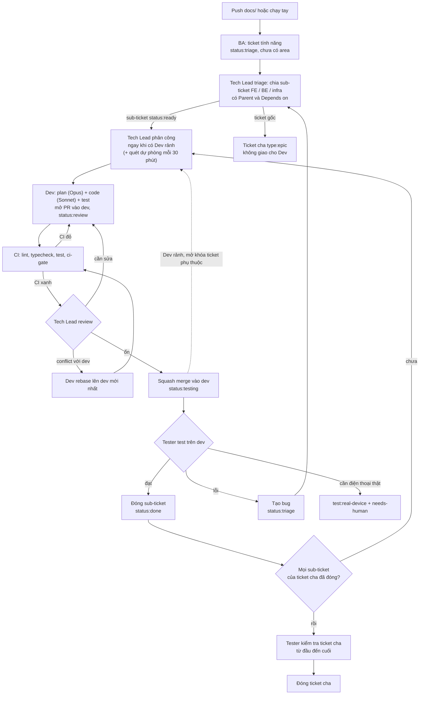

# MoneyMates – AI Software Factory

Cập nhật: 23/11/2026 · Hoàng Lê · Trạng thái: **đã triển khai và chạy thật** (BA → triage → Dev → review → Tester đã chạy hết một vòng). Hướng dẫn cài đặt và vận hành cho người nằm ở `docs/factory-setup.md`; quy tắc cho agent nằm ở `CLAUDE.md`.

## Ý tưởng

Dự án được làm như một dây chuyền: con người chỉ chuẩn bị đầu vào (`docs/`), còn 4 AI agent — **BA, Tech Lead, Dev, Tester** — tự tạo ticket, code, review, merge và test trên GitHub. Các role mô phỏng một team làm thủ công, mỗi role là một agent với prompt riêng (`.claude/agents/`) và các skill dùng chung (`.claude/skills/`).

- Tất cả agent chạy bằng **Claude Code GitHub Actions** dưới **một danh tính GitHub** (app Claude chính thức), không cần tài khoản riêng cho từng role, xác thực bằng **gói Claude Pro** của chủ repo.
- **Agent chỉ đọc, viết code và ghi kết quả vào `.factory/result.json`. Việc đổi label, đặt commit status, merge và đóng ticket do các script của workflow làm** (`scripts/factory/`), theo quy tắc cố định, nên agent không thể tự đổi trạng thái sai. Mỗi script xong việc thì **chủ động gọi workflow của bước tiếp theo** (`workflow_dispatch`), vì GitHub không kích hoạt workflow từ thao tác dùng `GITHUB_TOKEN`.
- Có **3 agent Dev chạy song song**: **Dev FE** (mobile), **Dev BE** (API), **Dev Fullstack** (ticket chạm cả hai, hạ tầng, hoặc nhận thêm việc khi hàng chờ dài). Mỗi Dev làm một ticket tại một thời điểm; PR nào xong trước thì merge trước, PR bị conflict thì Dev đó tự rebase.
- **Mô hình:** BA và bước lên plan của Dev dùng **Opus** để phân tích kỹ, tránh sót. Bước code của Dev, Tech Lead và Tester dùng **Sonnet** để tiết kiệm hạn mức. Đổi trong `.github/factory.env`.

## Hai cấp ticket

BA không biết Dev sẽ làm thế nào, nên **BA chỉ viết ticket tính năng theo góc nhìn người dùng**, không chia FE/BE và không gắn `area:*`. **Tech Lead đọc từng ticket tính năng rồi chia thành sub-ticket theo từng Dev** (khi triage).

| Cấp | Ai tạo | Nội dung | Ai làm |
| --- | --- | --- | --- |
| **Ticket tính năng** | BA | Người dùng làm được gì; tiêu chí chấp nhận từ đầu đến cuối; không có chi tiết kỹ thuật | Không ai code trực tiếp. Sau triage nó thành **ticket cha** (`type:epic`, không có status, không bao giờ được giao) |
| **Sub-ticket** | Tech Lead | Một PR công việc kỹ thuật cho một khu vực (`area:mobile` / `area:api` / `area:infra`, hoặc cả hai nếu không nên tách), có `Parent: #N` và `Depends on #N` | Dev FE, BE hoặc Fullstack |

Tech Lead bảo đảm các sub-ticket **cùng nhau phủ hết** tiêu chí chấp nhận của ticket cha, và sắp thứ tự phụ thuộc (nền tảng → schema/hợp đồng API → endpoint → màn hình gọi endpoint). Khi **mọi sub-ticket đã đóng**, Tester kiểm tra ticket cha từ đầu đến cuối rồi mới đóng nó.

## Vai trò từng agent

| Agent | Kích hoạt khi | Việc làm | Kết quả |
| --- | --- | --- | --- |
| **BA** (Opus) | Push thay đổi yêu cầu trong `docs/` (không tính `factory-setup.md`, `ai-software-factory.md`, `design/`), hoặc chạy tay | Đọc plan/requirements, so với issue đã có (kể cả đã đóng), tạo ticket tính năng mới có tiêu chí chấp nhận; không tạo trùng; tối đa `MAX_BA_ISSUES_PER_RUN` ticket mỗi lần | Issue mới gắn `status:triage` + `type:feature` + `priority:*` |
| **Tech Lead – Triage** (Sonnet) | Có issue `status:triage` (từ BA hoặc bug từ Tester) | Làm theo từng lô tối đa `MAX_TRIAGE_PER_RUN` ticket, ưu tiên cao trước; làm rõ ticket, **chia thành sub-ticket theo khu vực**, gắn phụ thuộc, loại, ưu tiên. Còn ticket thì tự gọi lô tiếp theo | Sub-ticket `status:ready`; ticket tính năng thành ticket cha |
| **Tech Lead – Phân công** (Sonnet) | **Ngay khi có Dev rảnh hoặc có ticket mới `ready`** (sau merge, sau khi một ticket bị kẹt `needs-human`, sau triage), và quét dự phòng mỗi 30 phút | Với từng Dev đang rảnh: chọn ticket ưu tiên cao nhất, đúng chuyên môn, đã đủ điều kiện phụ thuộc, không trùng module với việc đang làm | Gắn `agent:dev-fe` / `agent:dev-be` / `agent:dev-fullstack` + `status:in-progress` |
| **Dev FE / BE / Fullstack** (plan Opus, code Sonnet) | Được giao ticket, Tech Lead yêu cầu sửa, CI đỏ, hoặc PR bị conflict | Lên plan (comment trên ticket), tạo nhánh `feat/<số>-<slug>`, code + test, mở PR vào `dev`; có góp ý thì sửa và push tiếp; bị conflict thì rebase lên `dev` mới nhất | PR + `status:review` |
| **Tech Lead – Review** (Sonnet) | CI chạy xong trên PR | CI đỏ thì trả về Dev. CI xanh thì review theo từng tiêu chí chấp nhận và quy tắc repo; chưa ổn thì comment + check đỏ; ổn thì check xanh và **squash merge ngay** | Merge vào `dev`, `status:testing` |
| **Tester** (Sonnet) | Có merge mới vào `dev` | Chỉ test trên nhánh `dev`: workflow chạy toàn bộ test (unit, API, golden, E2E); Tester đối chiếu từng tiêu chí chấp nhận với code và kết quả test; lỗi thì tạo ticket bug | Đóng ticket (`status:done`) hoặc tạo bug `status:triage` |

## Flow một tính năng

## Label – "máy trạng thái"

| Label | Ý nghĩa |
| --- | --- |
| `status:triage` | Ticket mới, chờ Tech Lead kiểm tra |
| `status:ready` | Đã duyệt, chờ phân công |
| `agent:dev-fe` / `agent:dev-be` / `agent:dev-fullstack` | Đã giao cho Dev tương ứng |
| `status:in-progress` | Dev đang làm |
| `status:review` | Có PR, chờ Tech Lead review |
| `status:changes-requested` | Tech Lead (hoặc CI đỏ) yêu cầu sửa |
| `status:needs-rebase` | PR bị conflict với `dev`, chờ Dev rebase |
| `status:testing` | Đã merge vào `dev`, chờ Tester |
| `status:done` | Đã test xong, đóng |
| `needs-human` | Agent bị kẹt, mọi workflow bỏ qua ticket này chờ người xử lý |
| `test:real-device` | Cần kiểm tra trên điện thoại thật (đi kèm `needs-human`) |
| `type:feature` / `type:bug` / `type:chore` | Loại ticket |
| `type:epic` | Ticket cha đã được chia sub-ticket; không giao cho Dev; Tester kiểm tra từ đầu đến cuối khi mọi sub-ticket đã đóng |
| `priority:p0`…`p3` | Ưu tiên (p0 cao nhất) |
| `area:mobile` / `area:api` / `area:infra` | Khu vực code, **do Tech Lead gắn** (ticket BA chưa có) |
| `report:weekly` | Issue báo cáo hằng tuần |

Mỗi ticket chỉ có một label `status:*` tại một thời điểm. Ticket cha (`type:epic`) không có label status.

## Tech Lead duyệt PR thế nào (khi dùng chung một danh tính)

GitHub không cho cùng một danh tính vừa mở PR vừa bấm "Approve", nên Tech Lead duyệt bằng **commit status** thay vì nút Approve:

- Review xong, workflow đặt check `tech-lead-review` trên commit của PR: **đỏ** kèm comment góp ý, hoặc **xanh** rồi squash merge ngay. Nội dung commit merge là tiêu đề PR cộng `Refs #N`, không ghép nội dung các commit con.
- Mục tiêu của ruleset trên `dev`: chỉ merge khi **`ci-gate` và `tech-lead-review` xanh**. Cấu hình sẵn ở `.github/rulesets/`, **cần gói GitHub Pro** vì repo đang private (gói Free báo 403). Khi chưa có ruleset, workflow vẫn chỉ merge sau khi CI xanh và Tech Lead duyệt, nhưng không có gì chặn người merge tay.

## 3 Dev chạy song song

**Phân công (Tech Lead, liên tục)**

| Dev | Nhận ticket | Ví dụ |
| --- | --- | --- |
| Dev FE | `area:mobile` | Màn hình, quét QR, VietQR, SQLite trên máy |
| Dev BE | `area:api` | Django API, endpoint AI, giới hạn request |
| Dev Fullstack | Ticket chạm cả `area:mobile` và `area:api`, `area:infra`, hoặc nhận thêm việc của FE/BE khi Dev đó đang bận và hàng chờ dài | Voice/bill: màn hình + endpoint AI; CI, scaffolding |

- Mỗi Dev chỉ giữ **một ticket đang làm** (đang code, chờ review, đang sửa hoặc đang rebase). **Ngay khi PR được merge, Dev đó rảnh và được giao ticket tiếp theo**, không phải chờ vòng quét 30 phút. Việc giao chỉ gọi Claude khi có Dev rảnh **và** có ticket hợp chuyên môn; nhiều sự kiện đến cùng lúc thì gộp thành một lượt.
- Quét 30 phút (và bước "resume") chỉ còn là **lưới an toàn**, ví dụ sau khi hết hạn mức Pro. Lịch của GitHub Actions có thể trễ vài phút; không ảnh hưởng flow.
- Tech Lead **tránh giao cùng lúc hai ticket sửa cùng một module** (ví dụ hai ticket cùng đụng schema DB) để giảm conflict; ticket còn lại chờ lượt sau.
- Ticket có phụ thuộc chỉ được giao khi các ticket nó phụ thuộc đã merge vào `dev`.

**Merge và conflict**

- PR nào CI xanh và Tech Lead duyệt trước thì **merge trước**, không chờ PR khác.
- Mỗi lần có merge vào `dev`, một workflow kiểm tra các PR đang mở; PR nào bị conflict thì gắn `status:needs-rebase` và gọi đúng Dev của PR đó.
- Dev **rebase nhánh của mình lên `dev` mới nhất**, sửa conflict, chạy lại test, push (`--force-with-lease`, chỉ trên nhánh `feat/*` hoặc `fix/*` của mình), rồi PR quay lại hàng review.
- Rebase quá số lần cho phép (trong `factory.env`) thì gắn `needs-human`.

## Tester test thế nào

Tester chạy trên **GitHub Actions** (runner Linux của GitHub), không chạy trên máy cá nhân, nên **máy người không cần Android Studio hay máy ảo**. Nếu cần máy ảo, máy ảo cũng chạy trên runner.

| Mức test | Cần máy ảo? | Phạm vi |
| --- | --- | --- |
| Unit test | Không | Chia tiền, quyết toán, đọc/tạo VietQR (TLV + CRC), tự chọn danh mục, parse "50k"/"1tr2" |
| Golden test | Không | Ca chuẩn trong `tests/golden/` (người sở hữu, Dev không được sửa) |
| API test | Không | Endpoint Django `/ai/parse-*` với AI được giả lập (mock), giới hạn request |
| E2E (bấm UI như người dùng) | Có – **Android emulator chạy trong CI** | Các flow chính: thêm giao dịch, tạo nhóm, chia tiền, Tổng kết, QR đòi tiền |

- **Cách làm việc:** workflow chạy test và E2E; sau đó Tester (Claude) đối chiếu từng tiêu chí chấp nhận với code và kết quả test (nó **đọc và đối chiếu, không tự chạy lại lệnh, không tự viết test**). Test lỗi ngay trên `dev` thì workflow tự mở bug hồi quy mức p0.
- **E2E:** build APK, chạy Maestro trên Android emulator, chụp màn hình khi lỗi và đính kèm vào kết quả. Chỉ chạy khi có `apps/mobile/.maestro`.
- **Chỉ Android ở giai đoạn đầu:** iOS simulator cần runner macOS, tốn phút CI hơn nhiều; thêm sau nếu cần.
- **E2E chỉ chạy khi merge vào `dev`**, không chạy mỗi lần push, vì chậm hơn unit test.
- **Dữ liệu giả lập trong E2E:** emulator không có app ngân hàng, camera thật hay giọng nói thật, nên E2E nạp sẵn chuỗi QR mẫu, câu voice đã chuyển chữ, kết quả AI mẫu.
- **Phần chỉ test được trên điện thoại thật** (deeplink ngân hàng, quét QR bằng camera, nhận giọng nói tiếng Việt): Tester gắn `test:real-device` + `needs-human`; người test bằng bản build cài lên điện thoại. Android Studio chỉ cần nếu người muốn tự xem/debug trên máy ảo ở máy mình (không bắt buộc).

## Nhánh

- `dev`: nhánh tích hợp, mọi PR của Dev vào đây, Tester chỉ test ở đây.
- `main`: nhánh phát hành, **chỉ người cập nhật**; agent không bao giờ push hay mở PR vào `main`.
- Nhánh làm việc: `feat/<số issue>-<slug>`, `fix/<số issue>-<slug>`. Số issue trong tên nhánh là cách workflow nối PR với ticket.

## Con người làm gì

**Setup một lần** (chi tiết từng bước trong `docs/factory-setup.md`)

1. Tạo repo, nhánh `main` và `dev`, đưa tài liệu vào `docs/`. Xuất thiết kế vào `docs/design/` (agent trong CI không mở được link artifact của claude.ai).
2. Cài Claude GitHub App vào repo. Dùng **gói Claude Pro**: chạy `claude setup-token` trên máy để lấy token, lưu thành secret `CLAUDE_CODE_OAUTH_TOKEN` (không dùng `ANTHROPIC_API_KEY`).
3. Tạo biến repo `FACTORY_ENABLED` (để `false` khi chưa sẵn sàng) và chạy `scripts/setup-labels.sh` một lần.
4. Bật ruleset cho `dev` và `main` từ `.github/rulesets/` (cần GitHub Pro).
5. Viết các ca chuẩn vào `tests/golden/` (có thể thêm mã VietQR thật từ app ngân hàng của bạn).
6. Bộ file của factory (`CLAUDE.md`, `.claude/agents/`, `.claude/skills/`, `.claude/hooks/`, `.github/workflows/`, `.github/factory.env`, template issue/PR, `scripts/`) đã có trong repo. Bật `FACTORY_ENABLED=true` rồi chạy workflow **BA** bằng tay lần đầu.

**Hằng ngày**

- Xem danh sách issue theo label để biết tiến độ, hoặc đọc báo cáo hằng tuần (issue `report:weekly`).
- Xử lý hàng `needs-human`: ticket review quá số vòng cho phép, CI đỏ mãi, spec mơ hồ, việc cần sửa `.github/workflows/` (agent không có quyền), hoặc việc chỉ test được trên điện thoại thật.
- Đổi yêu cầu: sửa file yêu cầu trong `docs/` rồi push, BA tự tạo/cập nhật ticket.
- Phát hành (khuyến nghị làm tay): merge `dev` → `main`, build app, deploy Django lên Hawk Host.
- Dừng khẩn cấp: đặt `FACTORY_ENABLED=false`, mọi agent ngừng.

## Rào chắn

- **Mỗi Dev một ticket tại một thời điểm** (workflow dùng concurrency theo từng Dev); tối đa 3 Dev chạy song song.
- **Giới hạn trong `.github/factory.env`**: số vòng review tối đa (3), số lần sửa CI tối đa (3), số lần rebase tối đa (3), số lần agent lỗi liên tiếp (2), số ticket BA tạo mỗi lần (10), số ticket triage mỗi lượt (3), số Dev chạy song song, số lượt chạy mỗi Dev mỗi ngày, số lượt tối đa (turn) và mô hình của từng agent. Vượt giới hạn thì gắn `needs-human` và dừng, không lặp vô hạn.
- **Test cố định cho logic tiền** (`tests/golden/`): chia tiền, quyết toán, VietQR, tự chọn danh mục. Dev không được sửa các test này.
- **Không secret trong code**: key chỉ nằm trong GitHub secrets và env trên server. Hook chặn agent đọc/ghi `.env` và file khóa.
- **Hook bảo vệ** (`.claude/settings.json`): agent không được sửa `docs/`, `tests/golden/`, và trong CI không được sửa `.github/`, `.claude/`; không push thẳng vào `dev`/`main`; chỉ `--force-with-lease` trên nhánh `feat/*`, `fix/*`; agent trong CI không được tự merge hay đổi label trạng thái.
- **Không để lại dấu AI**: commit không có dòng `Co-Authored-By`, mô tả PR không có chữ "Generated with Claude Code". Hook và CI cùng kiểm tra.
- **Định dạng code**: Prettier cho toàn repo (hook chạy sau mỗi lần sửa, CI kiểm tra), ruff cho Python.

## Dùng gói Claude Pro: hết limit thì dừng, reset thì chạy tiếp

- Agent xác thực bằng `CLAUDE_CODE_OAUTH_TOKEN` của gói Pro, nên **không phát sinh phí API**; mỗi lần agent chạy trừ vào hạn mức dùng của gói Pro.
- **Hạn mức dùng chung** với việc bạn chat trên claude.ai và dùng Claude Code trên máy: factory chạy nhiều thì bạn còn ít lượt cho việc khác, và ngược lại.
- **Khi hết hạn mức:** lần chạy của agent kết thúc với trạng thái "tạm dừng" (workflow xanh, kèm cảnh báo). Ticket **giữ nguyên label trạng thái**, không bị gắn `needs-human`, không tính là một lần thất bại.
- **Khi hạn mức reset:** lượt quét 30 phút (bước "resume") tìm các ticket/PR đang dở mà không có agent nào chạy, rồi kích hoạt lại đúng agent. Không cần làm gì bằng tay.
- **Agent hết số lượt (turn) nhưng đã ghi kết quả một phần** (như triage): workflow vẫn áp dụng phần đã xong thay vì bỏ hết.
- 6 agent với 3 Dev song song sẽ chạm hạn mức Pro khá nhanh; factory sẽ chạy theo từng đợt (chạy → hết limit → chờ reset → chạy tiếp). Muốn nhanh hơn thì nâng gói hoặc giảm số Dev chạy song song (cấu hình trong `factory.env`).

## Chi phí

Agent dùng hạn mức gói Claude Pro (không tính phí theo token). Ngoài ra tốn phút GitHub Actions: repo private có số phút miễn phí mỗi tháng tùy gói GitHub, E2E trên Android emulator tốn phút nhất. Một ticket thường qua khoảng 4–6 lần chạy (Dev, review, sửa, review lại, test), cộng thêm lượt rebase khi conflict. Với 3 Dev song song, hạn mức gói Pro bị dùng nhanh hơn khoảng 3 lần so với 1 Dev, đổi lại làm nhanh hơn trong mỗi đợt. Số liệu thực tế từ lần chạy đầu: một ticket hạ tầng nhỏ mất khoảng 6 phút cho Dev (plan Opus 9 lượt, code Sonnet 30 lượt).

## Câu hỏi còn mở (thảo luận tiếp)

- [x] Tester test tới mức nào → đã chốt: unit + golden + API test + E2E trên Android emulator trong CI (xem mục "Tester test thế nào").
- [x] Tester chỉ chạy test và báo bug, không tự viết thêm test vào repo.
- [x] Ticket, PR, commit viết bằng tiếng Anh.
- [x] Tech Lead phân công liên tục khi có Dev rảnh (quét 30 phút chỉ để dự phòng); 3 Dev (FE, BE, Fullstack) chạy song song.
- [x] BA chỉ viết ticket tính năng; Tech Lead chia sub-ticket theo từng Dev.
- [x] Có báo cáo tổng kết hằng tuần (issue: xong gì, kẹt gì, bao nhiêu lượt chạy).
- [x] Phát hành `dev` → `main`: người tự làm.
- [x] Giới hạn chi phí: dùng hạn mức gói Claude Pro, hết limit thì dừng, reset thì chạy tiếp (xem mục "Dùng gói Claude Pro").
- [ ] Ruleset cho `dev`/`main`: chờ nâng cấp GitHub Pro (hiện repo private, gói Free).
- [ ] Cho phép Dev làm tiếp ticket kế trong lúc PR chờ review (nhanh hơn nhưng tăng nguy cơ conflict): chưa làm, hiện mỗi Dev giữ một ticket đến khi PR được merge.
