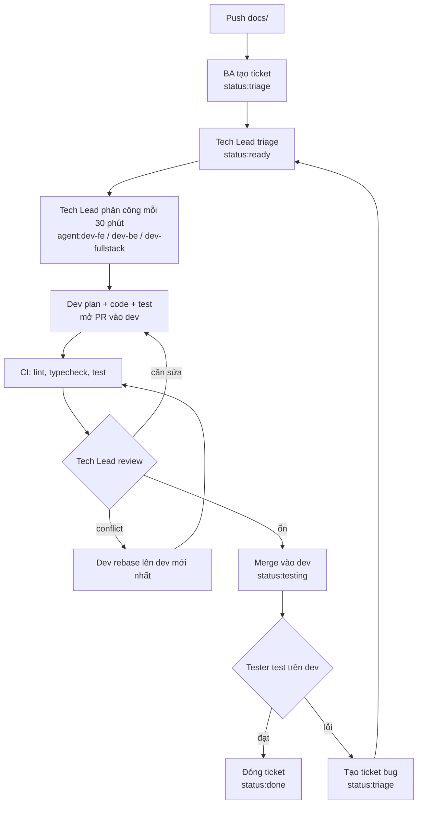

# MoneyMates – AI Software Factory

Cập nhật: 23/11/2026 · Hoàng Lê · Trạng thái: **bản thảo để thảo luận** trước khi tạo bộ setup.

## Ý tưởng

Dự án được làm như một dây chuyền: con người chỉ chuẩn bị đầu vào (`docs/`), còn 4 AI agent — **BA, Tech Lead, Dev, Tester** — tự tạo ticket, code, review, merge và test trên GitHub. Các role mô phỏng một team làm thủ công, mỗi role là một agent với prompt riêng.

- Tất cả agent chạy bằng **Claude Code GitHub Actions** dưới **một danh tính GitHub** (app Claude chính thức), không cần tài khoản riêng cho từng role, xác thực bằng **gói Claude Pro** của chủ repo.
- Agent "nói chuyện" với nhau bằng **label trên GitHub Issue/PR**: đổi label là kích hoạt agent của bước tiếp theo.
- Có **3 agent Dev chạy song song**: **Dev FE** (mobile), **Dev BE** (API), **Dev Fullstack** (ticket chạm cả hai). Mỗi Dev làm một ticket tại một thời điểm; PR nào xong trước thì merge trước, PR bị conflict thì Dev đó tự rebase.

## Vai trò từng agent

| Agent | Kích hoạt khi | Việc làm | Kết quả |
| --- | --- | --- | --- |
| **BA** | Push thay đổi trong `docs/`, hoặc chạy tay | Đọc plan/requirements, so với issue đã có, tạo ticket mới (có tiêu chí chấp nhận), gom theo epic; không tạo trùng | Issue mới gắn `status:triage` |
| **Tech Lead – Triage** | Issue có `status:triage` (từ BA hoặc bug từ Tester) | Kiểm tra ticket rõ ràng, đủ nhỏ, có phụ thuộc; sửa/tách ticket; gắn ưu tiên | `status:ready` |
| **Tech Lead – Phân công** | Mỗi 30 phút | Với từng Dev đang rảnh: chọn ticket ưu tiên cao nhất, đúng chuyên môn, đã đủ điều kiện | Gắn `agent:dev-fe` / `agent:dev-be` / `agent:dev-fullstack` |
| **Dev FE / BE / Fullstack** | Issue gắn label agent của mình, Tech Lead yêu cầu sửa, hoặc PR bị conflict | Lên plan (comment), tạo nhánh `feat/<số>`, code + test, mở PR vào `dev`; có góp ý thì sửa và push tiếp đến khi hết góp ý; bị conflict thì rebase lên `dev` mới nhất | PR + `status:review` |
| **Tech Lead – Review** | CI chạy xong trên PR | Review theo tiêu chí chấp nhận và quy tắc repo; chưa ổn thì comment + check đỏ; ổn thì check xanh và merge ngay (không chờ PR khác) | Merge vào `dev`, `status:testing` |
| **Tester** | Có merge mới vào `dev` | Chỉ test trên nhánh `dev`: chạy toàn bộ test, đối chiếu từng tiêu chí chấp nhận; lỗi thì tạo ticket bug | Đóng ticket (`status:done`) hoặc tạo bug `status:triage` |

## Flow một ticket

## Label – "máy trạng thái"

| Label | Ý nghĩa |
| --- | --- |
| `status:triage` | Ticket mới, chờ Tech Lead kiểm tra |
| `status:ready` | Đã duyệt, chờ phân công |
| `agent:dev-fe` / `agent:dev-be` / `agent:dev-fullstack` | Đã giao cho Dev tương ứng (kích hoạt Dev đó) |
| `status:needs-rebase` | PR bị conflict với `dev`, chờ Dev rebase |
| `status:in-progress` | Dev đang làm |
| `status:review` | Có PR, chờ Tech Lead review |
| `status:changes-requested` | Tech Lead yêu cầu sửa |
| `status:testing` | Đã merge vào `dev`, chờ Tester |
| `status:done` | Đã test xong, đóng |
| `needs-human` | Agent bị kẹt, bỏ qua ticket này chờ người xử lý |
| `type:feature` / `type:bug` / `type:chore` | Loại ticket |
| `priority:p0`…`p3` | Ưu tiên (p0 cao nhất) |
| `area:mobile` / `area:api` / `area:infra` | Khu vực code |

Mỗi ticket chỉ có một label `status:*` tại một thời điểm.

## Tech Lead duyệt PR thế nào (khi dùng chung một danh tính)

GitHub không cho cùng một danh tính vừa mở PR vừa bấm "Approve", nên Tech Lead duyệt bằng **status check** thay vì nút Approve:

- Review xong, Tech Lead đặt check `tech-lead-review` trên PR: **đỏ** kèm comment góp ý, hoặc **xanh** rồi tự merge.
- Branch protection của `dev`: chỉ merge khi **CI xanh và `tech-lead-review` xanh**.
- Kết quả: Tech Lead vẫn là cửa duyệt duy nhất vào `dev`.

## 3 Dev chạy song song

**Phân công (Tech Lead, mỗi 30 phút)**

| Dev | Nhận ticket | Ví dụ |
| --- | --- | --- |
| Dev FE | `area:mobile` | Màn hình, quét QR, VietQR, SQLite trên máy |
| Dev BE | `area:api` | Django API, endpoint AI, giới hạn request |
| Dev Fullstack | Ticket chạm cả `area:mobile` và `area:api`, `area:infra`, hoặc nhận thêm việc của FE/BE khi Dev đó đang bận và hàng chờ dài | Voice/bill: màn hình + endpoint AI; CI, scaffolding |

- Mỗi Dev chỉ giữ **một ticket đang làm** (đang code, chờ review, đang sửa hoặc đang rebase). Xong ticket mới nhận ticket tiếp.
- Tech Lead **tránh giao cùng lúc hai ticket sửa cùng một module** (ví dụ hai ticket cùng đụng schema DB) để giảm conflict; ticket còn lại chờ lượt sau.
- Ticket có phụ thuộc chỉ được giao khi các ticket nó phụ thuộc đã merge vào `dev`.
- Lịch chạy của GitHub Actions có thể trễ vài phút so với mốc 30 phút; không ảnh hưởng flow.

**Merge và conflict**

- PR nào CI xanh và Tech Lead duyệt trước thì **merge trước**, không chờ PR khác.
- Mỗi lần có merge vào `dev`, một workflow kiểm tra các PR đang mở; PR nào bị conflict thì gắn `status:needs-rebase` và gọi đúng Dev của PR đó.
- Dev **rebase nhánh của mình lên `dev` mới nhất**, sửa conflict, chạy lại test, push (`--force-with-lease`, chỉ trên nhánh của mình), rồi PR quay lại hàng review.
- Rebase quá số lần cho phép (trong `factory.env`) thì gắn `needs-human`.

## Tester test thế nào

Tester chạy trên **GitHub Actions** (runner Linux của GitHub), không chạy trên máy cá nhân, nên **máy người không cần Android Studio hay máy ảo**. Nếu cần máy ảo, máy ảo cũng chạy trên runner.

| Mức test | Cần máy ảo? | Phạm vi |
| --- | --- | --- |
| Unit test | Không | Chia tiền, quyết toán, đọc/tạo VietQR (TLV + CRC), tự chọn danh mục, parse "50k"/"1tr2" |
| API test | Không | Endpoint Django `/ai/parse-*` với AI được giả lập (mock), giới hạn request |
| E2E (bấm UI như người dùng) | Có – **Android emulator chạy trong CI** | Các flow chính: thêm giao dịch, tạo nhóm, chia tiền, Tổng kết, QR đòi tiền |

- **Cách chạy E2E:** workflow của Tester khởi động Android emulator trên runner Linux, cài bản build của app, chạy kịch bản test (Maestro hoặc Detox), chụp màn hình khi lỗi và đính kèm vào ticket bug.
- **Chỉ Android ở giai đoạn đầu:** iOS simulator cần runner macOS, tốn phút CI hơn nhiều; thêm sau nếu cần.
- **E2E chỉ chạy khi merge vào `dev`**, không chạy mỗi lần push, vì chậm hơn unit test.
- **Dữ liệu giả lập trong E2E:** emulator không có app ngân hàng, camera thật hay giọng nói thật, nên E2E nạp sẵn chuỗi QR mẫu, câu voice đã chuyển chữ, kết quả AI mẫu.
- **Phần chỉ test được trên điện thoại thật** (deeplink ngân hàng, quét QR bằng camera, nhận giọng nói tiếng Việt): Tester gắn `needs-human`; người test bằng bản build cài lên điện thoại. Android Studio chỉ cần nếu người muốn tự xem/debug trên máy ảo ở máy mình (không bắt buộc).

## Nhánh

- `dev`: nhánh tích hợp, mọi PR của Dev vào đây, Tester chỉ test ở đây.
- `main`: nhánh phát hành, **chỉ người cập nhật**; agent không bao giờ push hay mở PR vào `main`.
- Nhánh làm việc: `feat/<số issue>-<slug>`, `fix/<số issue>-<slug>`.

## Con người làm gì

**Setup một lần**

1. Tạo repo, tạo nhánh `main` và `dev`, đưa `docs/plan.md`, `docs/tech-stack.md`, file này vào `docs/`.
2. Cài app Claude vào repo (`/install-github-app` trong Claude Code). Dùng **gói Claude Pro**: chạy `claude setup-token` trên máy để lấy token, lưu thành secret `CLAUDE_CODE_OAUTH_TOKEN` (không dùng `ANTHROPIC_API_KEY`).
3. Bật branch protection cho `dev`: bắt buộc check CI và `tech-lead-review`.
4. Thêm bộ file setup (sẽ tạo sau khi chốt file này): `CLAUDE.md`, prompt 4 agent trong `.github/agents/`, workflow trong `.github/workflows/`, issue template, script tạo label, file giới hạn `.github/factory.env`.
5. Chạy script tạo label một lần, rồi bật biến repo `FACTORY_ENABLED=true`.

**Hằng ngày**

- Xem danh sách issue theo label để biết tiến độ.
- Xử lý hàng `needs-human`: ticket review quá số vòng cho phép, CI đỏ mãi, spec mơ hồ, hoặc việc chỉ test được trên điện thoại thật (deeplink ngân hàng, camera, giọng nói tiếng Việt).
- Đổi yêu cầu: sửa `docs/plan.md` rồi push, BA tự tạo/cập nhật ticket.
- Phát hành (khuyến nghị làm tay): merge `dev` → `main`, build app, deploy Django lên Hawk Host.
- Dừng khẩn cấp: đặt `FACTORY_ENABLED=false`, mọi agent ngừng.

## Rào chắn

- **Mỗi Dev một ticket tại một thời điểm** (workflow dùng concurrency theo từng Dev); tối đa 3 Dev chạy song song.
- **Giới hạn trong `.github/factory.env`**: số lượt chạy mỗi Dev mỗi ngày, số ticket BA tạo mỗi lần, số vòng review tối đa (ví dụ 3), số lần sửa CI tối đa, số lần rebase tối đa. Vượt giới hạn thì gắn `needs-human` và dừng, không lặp vô hạn.
- **Test cố định cho logic tiền** (`tests/golden/`): chia tiền, quyết toán, VietQR, tự chọn danh mục. Dev không được sửa các test này.
- **Không secret trong code**: key chỉ nằm trong GitHub secrets và env trên server.

## Dùng gói Claude Pro: hết limit thì dừng, reset thì chạy tiếp

- Agent xác thực bằng `CLAUDE_CODE_OAUTH_TOKEN` của gói Pro, nên **không phát sinh phí API**; mỗi lần agent chạy trừ vào hạn mức dùng của gói Pro.
- **Hạn mức dùng chung** với việc bạn chat trên claude.ai và dùng Claude Code trên máy: factory chạy nhiều thì bạn còn ít lượt cho việc khác, và ngược lại.
- **Khi hết hạn mức:** lần chạy của agent báo lỗi và dừng. Ticket **giữ nguyên label trạng thái**, không bị gắn `needs-human`, không tính là một lần thất bại.
- **Khi hạn mức reset:** lượt quét 30 phút của Tech Lead (và một bước "resume" trong cùng workflow) tìm các ticket/PR đang dở mà không có agent nào chạy, rồi kích hoạt lại đúng agent. Không cần làm gì bằng tay.
- 6 agent với 3 Dev song song sẽ chạm hạn mức Pro khá nhanh; factory sẽ chạy theo từng đợt (chạy → hết limit → chờ reset → chạy tiếp). Muốn nhanh hơn thì nâng gói hoặc giảm số Dev chạy song song (cấu hình trong `factory.env`).

## Chi phí

Agent dùng hạn mức gói Claude Pro (không tính phí theo token). Ngoài ra tốn phút GitHub Actions: repo private có số phút miễn phí mỗi tháng tùy gói GitHub, E2E trên Android emulator tốn phút nhất. Một ticket thường qua khoảng 4–6 lần chạy (Dev, review, sửa, review lại, test), cộng thêm lượt rebase khi conflict. Với 3 Dev song song, hạn mức gói Pro bị dùng nhanh hơn khoảng 3 lần so với 1 Dev, đổi lại làm nhanh hơn trong mỗi đợt.

## Câu hỏi còn mở (thảo luận tiếp)

- [x] Tester test tới mức nào → đã chốt: unit + API test + E2E trên Android emulator trong CI (xem mục "Tester test thế nào").
- [x] Tester chỉ chạy test và báo bug, không tự viết thêm test vào repo.
- [x] Ticket, PR, commit viết bằng tiếng Anh.
- [x] Tech Lead phân công mỗi 30 phút; 3 Dev (FE, BE, Fullstack) chạy song song.
- [x] Có báo cáo tổng kết hằng tuần (issue: xong gì, kẹt gì, tốn bao nhiêu).
- [x] Phát hành `dev` → `main`: người tự làm.
- [x] Giới hạn chi phí: dùng hạn mức gói Claude Pro, hết limit thì dừng, reset thì chạy tiếp (xem mục "Dùng gói Claude Pro").
