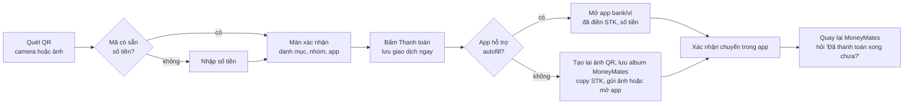

# MoneyMates – Plan chức năng & giao diện

Cập nhật: 22/11/2026 · Hoàng Lê

## Tổng quan & giả định

App ghi thu chi trên iOS và Android, ghi giao dịch nhanh nhất có thể: quét QR rồi chuyển sang app bank/ví, nhập tay, nói, hoặc chụp bill. Có hai chế độ: chi tiêu cá nhân và chi tiêu nhóm theo từng trip.

**Tên app: MoneyMates** — logo hướng A "Hai đồng xu" (có ký tự $), xem [MoneyMates – Logo](https://claude.ai/artifact/2m2qR4FeFweAJzbk9sTkUr#artboard-Main). Tên trên store dự kiến kèm phụ đề, ví dụ "MoneyMates: Thu chi & Chia tiền nhóm"; cần tra trùng tên trên App Store / Google Play trước khi phát hành (đã có vài app tên "MoneyMate").

Tech stack xem ở file `tech-stack.md`. Mockup giao diện: [App thu chi – Mockup](https://claude.ai/artifact/PxFxv62jrWscb7hbTVEAUu).

**Đã chốt**

- Bấm "Thanh toán" ở flow QR là lưu giao dịch ngay, không có trạng thái Pending. Giao dịch lỗi thì user tự vào xóa.
- QR trong nhóm mặc định người chi là chính chủ; nhập tay/voice/ảnh thì chọn được người chi.
- Danh mục có bộ mặc định luôn tồn tại (Ăn uống, Dịch vụ, Lưu trú…) và user được thêm/sửa/xóa danh mục riêng.
- AI (voice, ảnh bill) dùng model free của OpenRouter qua một endpoint Django; key nằm trên server, không nằm trong app.
- Loại khỏi phạm vi: widget, lưu người nhận, tự đọc thông báo bank để xác nhận.

**Chốt thêm ngày 22/11**

- Dữ liệu lưu trên máy, phần lõi chạy offline; chỉ AI cần mạng.
- v1 có cả cá nhân lẫn nhóm, gồm chia tiền và quyết toán.
- Quyết toán kiểu "Tôi thu hộ": mọi người chỉ trả/nhận với Tôi, khoản nào cũng có QR.
- Có ghi khoản thu.
- Thống kê tháng cá nhân cộng cả "phần tôi phải chịu" trong nhóm (trả 1tr cho 4 người thì tính 250k).
- v1 không đăng nhập, không sync, không backup.

## Phạm vi theo phase

v1 gồm toàn bộ luồng ghi chép và nhóm cơ bản; các thứ làm "đẹp" hơn để v2.

| Phase | Nội dung |
| --- | --- |
| v1 – Lõi | Quét QR + mở app bank/ví; nhập tay; danh mục (mặc định + CRUD); chi tiêu cá nhân; lịch sử + lọc; thống kê tháng; cảnh báo lệch >20% so với tháng trước; Hồ sơ + tài khoản nhận tiền của tôi |
| v1 – Nhóm | CRUD nhóm, thành viên theo tên, chọn người chi; chia tiền (đều / theo số tiền / theo tỷ lệ); Tổng kết từng người; QR đòi tiền theo từng thành viên + QR chung cả nhóm |
| v1 – AI | Voice: speech-to-text trên máy → tách số tiền/mô tả/danh mục (rule offline trước, LLM khi cần); ảnh bill → LLM vision đọc tổng tiền, tên quán, ngày |
| v2 – Nhóm nâng cao | Đa tiền tệ; khóa/lưu trữ trip; xuất ảnh tổng kết |
| v2 – Cá nhân nâng cao | Ngân sách theo danh mục; chi định kỳ (tiền nhà, điện, sub) |
| Sau này | Đăng nhập + sync nhiều máy; backup; mời thành viên nhóm bằng tài khoản thật (email/SĐT) |
| Khi phổ biến app – Free / Pro | Đăng nhập không bắt buộc; backup file cho Free; gói Pro gồm AI, lưu server, sync, tạo nhóm chung; thêm Phân tích chi tiêu bằng AI (xem mục 7) |
| Đã loại | Widget; lưu người nhận; đọc thông báo bank tự xác nhận |

## Chức năng chi tiết

### 1. Quét QR thanh toán

Quét xong là vào màn xác nhận; bấm Thanh toán thì lưu giao dịch rồi mới chuyển app.

Mục tiêu: nhập số tiền trong MoneyMates → app ngân hàng mở ra → thanh toán, càng ít bước càng tốt. Dùng được với **mọi app ngân hàng/ví có trong VietQR**, không chỉ vài app cố định. App không nhận điền sẵn vẫn đi tiếp được nhờ ảnh QR và clipboard. Không chuyển thì user xóa giao dịch ngay trên banner hoặc trong Lịch sử.

1. Mở camera từ nút QR giữa thanh điều hướng (có nút chọn ảnh QR từ thư viện).
2. Đọc mã VietQR trên máy: ngân hàng, số tài khoản, tên người nhận (nếu có), số tiền, nội dung.
3. Màn xác nhận:
    - Mã có số tiền → điền sẵn (cho sửa nếu mã tĩnh). Mã không có → bàn phím số bật sẵn.
    - Danh mục được chọn sẵn tự động (xem "Tự chọn danh mục" ở mục 2), đổi được; ghi chú; và dòng "Ghi vào" (mặc định theo quy tắc ở mục 4; trong nhóm người chi = chính chủ).
    - Chọn app thanh toán: danh sách **mọi** app bank/ví trong VietQR, có ô tìm kiếm. Thứ tự: app dùng gần đây và app yêu thích (theo Cài đặt) → app của ngân hàng trong mã QR → các app còn lại. Mỗi dòng có nhãn **"Tự điền"** (app nhận điền sẵn) hoặc **"Quét ảnh QR"** (các app khác).
    - Danh sách app lấy từ API (`GET /banks/apps`, server gộp danh sách deeplink và ngân hàng của VietQR, cache khoảng 24 giờ, VietQR lỗi thì trả bản tốt gần nhất). App có sẵn một bản danh sách để chạy offline và lần mở đầu. App không gọi VietQR trực tiếp.
4. Bấm **Thanh toán** → lưu giao dịch → mở app đã chọn:
    - App hỗ trợ autofill (hiện có MB Bank, VietinBank iPay, BIDV SmartBanking, ACB ONE, OCB OMNI) → mở link `dl.vietqr.io/pay` để app mở thẳng màn chuyển tiền đã điền STK, số tiền, nội dung. Có một bước chuyển nhanh qua trình duyệt, đó là cơ chế của VietQR.
    - App không hỗ trợ (Techcombank, TPBank, Vietcombank, MoMo…) → không qua trình duyệt:
        - Tạo lại ảnh VietQR với đúng ngân hàng, STK, số tiền và nội dung đã xác nhận (PNG 640 px, viền trắng 4 ô, đen trên trắng, không có tag tên merchant để app bank đọc được), lưu vào album "MoneyMates" để là ảnh mới nhất, và copy STK vào clipboard.
        - Android: gửi thẳng ảnh QR sang app đó (chia sẻ ảnh tới đúng package). App không nhận ảnh thì mở app; mở không được thì thử scheme riêng, cuối cùng là link VietQR.
        - iOS: mở app; ảnh QR đã nằm sẵn trong album.
        - **Lần đầu dùng mỗi ngân hàng loại này** hiện bottom sheet hướng dẫn ngắn ("Trong <bank>: bấm Quét QR → biểu tượng Ảnh → chọn ảnh đầu tiên") có ô "Không hiện lại". Những lần sau chỉ hiện thông báo ngắn.
    - App chưa cài hoặc không mở được → báo ngắn, thông tin đã nằm trong clipboard.
    - QR merchant không phải VietQR chuyển khoản → bắt nhập số tiền, lưu ảnh QR, mở app.
    - Không tự động thao tác trong app ngân hàng (accessibility, overlay…) và không dùng deeplink riêng không công khai.
5. Quay lại app thì thấy banner "Đã lưu <số tiền> · <nội dung>" có nút Xóa (nếu không chuyển), kèm câu hỏi một lần **"Đã thanh toán xong chưa?" (Đã trả / Chưa)**. Câu trả lời được nhớ theo từng ngân hàng (gửi ảnh thẳng có chạy không), lần sau chọn cách chuyển nhanh nhất đã biết.

### 2. Nhập chi tiêu/thu

Một màn nhập chung cho ba cách, kết quả AI luôn hiện ra để user sửa trước khi lưu.

- **Nhập tay:** loại (Chi/Thu), số tiền (hỗ trợ gõ "50k", "1tr2"), danh mục, ghi chú, ngày giờ, nguồn tiền (Tiền mặt / bank / ví / thẻ), ảnh đính kèm. Trong nhóm có thêm "Người chi".
- **Voice:** giữ nút mic nói "ăn phở 50 nghìn" → điền sẵn form. Trong nhóm nói "Nam trả tiền xăng 200k" thì tự chọn Nam nếu trùng tên thành viên. Nút mic có 4 trạng thái nhìn khác nhau rõ: chờ → **đang nghe** (vòng sáng nhịp theo âm lượng, chữ "Đang nghe…") → **đang xử lý** (spinner, "Đang xử lý…") → **xong** (dấu tick rồi form điền sẵn). Trạng thái đổi ngay khi chạm, có rung nhẹ khi bắt đầu và khi dừng.
- **Ảnh bill:** chụp hoặc chọn ảnh → AI đọc tổng tiền, tên quán, ngày, tự chọn danh mục → điền form, ảnh bill được đính kèm.
- AI lỗi hoặc hết quota → báo ngắn gọn, để form cho nhập tay, danh mục để "Khác".

**Tự chọn danh mục (quét QR, chụp bill, voice)**

App tự phân tích và chọn sẵn danh mục, user không phải chọn tay; không xác định được thì chọn "Khác".

- **Quét QR:** dựa vào tên người nhận và nội dung chuyển khoản (ví dụ "PHO", "CAFE", "GRAB") bằng bộ từ khóa trên máy; chưa khớp thì hỏi AI.
- **Voice:** rule offline tìm từ khóa trong câu nói; câu phức tạp thì AI.
- **Chụp bill:** AI chọn danh mục cùng lúc đọc tổng tiền, tên quán, món.
- **Không xác định được, AI lỗi hoặc hết quota:** chọn "Khác".
- AI nhận cả danh mục riêng của user, nên chọn được vào danh mục tự tạo.
- Danh mục tự chọn hiện rõ trên màn xác nhận / form, đổi được bằng một chạm.

### 3. Chi tiêu cá nhân

- Trang chủ: tổng chi/thu tháng này, so với tháng trước, banner cảnh báo khi lệch >20%.
- Lịch sử nhóm theo ngày; lọc theo tháng, danh mục, nguồn tiền, Chi/Thu; tìm theo ghi chú.
- Xem / sửa / xóa từng giao dịch (vuốt để xóa, có Hoàn tác).
- Thống kê: cơ cấu theo danh mục, xu hướng 6 tháng.

### 4. Chi tiêu nhóm

- CRUD nhóm: tên, biểu tượng, ngày bắt đầu/kết thúc (tuỳ chọn), tài khoản nhận tiền của nhóm (mặc định là TK chính trong Hồ sơ). Mỗi nhóm có history riêng.
- Thành viên: thêm bằng tên; "Tôi" lấy tên từ Hồ sơ, luôn có sẵn và không xóa được; không xóa thành viên đã có giao dịch (chỉ đổi tên).
- Trang nhóm: tổng chi cả trip, danh sách giao dịch, nút thêm chi tiêu và nút **Tổng kết**.
- Chia tiền cho từng khoản chi: Chia đều (mặc định, bỏ tick người không tham gia), Theo số tiền, Theo tỷ lệ. App báo khi tổng các phần chưa khớp số tiền.
- Màn Tổng kết:
    - Bảng từng người: Đã chi, Phần phải chịu, Chênh lệch (+ được nhận / − phải trả); bấm vào một người để xem các khoản chi tiết.
    - Danh sách quyết toán kiểu Tôi thu hộ: mỗi người chỉ trả hoặc nhận với Tôi, ví dụ "An trả Tôi 250.000đ", "Tôi trả Bình 100.000đ".
    - Khoản trả cho Tôi có nút QR → popup VietQR (TK nhận của tôi + đúng số tiền + nội dung "<Nhóm> <Tên>"), có Tải xuống và Chia sẻ.
    - Nút **QR chung**: VietQR không kèm số tiền, gửi cả nhóm để mọi người tự nhập.
    - Đánh dấu "Đã trả" từng khoản → ghi lại việc thanh toán để chênh lệch về 0.
- QR tạo ngay trên máy theo chuẩn VietQR, không cần mạng.
- Thống kê cá nhân cộng "phần tôi phải chịu" của mỗi khoản nhóm vào tháng phát sinh.
- Chọn nơi ghi khi có nhiều nhóm: một dòng "Ghi vào: <tên> ›", bấm mở danh sách Cá nhân + các nhóm, sắp theo dùng gần nhất, có ô tìm; nhóm đã kết thúc xếp cuối.
    - Mặc định = nơi ghi gần nhất (cá nhân hoặc nhóm).
    - Quay về Cá nhân nếu nhóm đó đã qua ngày kết thúc hoặc hơn 24 giờ chưa ghi gì.
    - Thêm chi tiêu từ trong trang nhóm thì luôn chọn sẵn nhóm đó.

### 5. Danh mục

- Mặc định (không xóa được, đổi được icon/màu): Ăn uống, Di chuyển, Lưu trú, Mua sắm, Dịch vụ, Hóa đơn, Giải trí, Sức khỏe, Khác. Thu: Lương, Được trả lại, Khác.
- Danh mục riêng: thêm/sửa/xóa; xóa thì chuyển các giao dịch cũ sang "Khác".
- Dùng chung cho cá nhân và nhóm.

### 6. Hồ sơ & cài đặt

- Hồ sơ: tên hiển thị (dùng làm "Tôi" trong nhóm), ảnh đại diện.
- Tài khoản nhận tiền của tôi: thêm/sửa/xóa nhiều TK (ngân hàng, STK, tên chủ TK), chọn một TK mặc định, xem trước QR. Dùng để tạo QR đòi tiền trong nhóm.
- Cài đặt: app thanh toán yêu thích (thứ tự hiển thị, kèm nhãn "Tự điền" / "Quét ảnh QR"), nguồn tiền, đơn vị tiền mặc định (VND). Nếu user có tài khoản ở ngân hàng hỗ trợ tự điền thì gợi ý đặt app đó làm mặc định (Đặt mặc định / Bỏ qua).
- Khóa app bằng Face ID / vân tay (tuỳ chọn).

### 6b. Cảm giác chạm & chuyển động

App phải phản hồi mọi thao tác, không đứng im. Dùng đúng màu và token của design, không thêm branding mới.

- Mọi nút, dòng danh sách, chip, tab, dòng chọn ngân hàng: khi nhấn thu nhỏ khoảng 0.97 hoặc mờ đi, 100–150 ms.
- Bottom sheet (Ghi vào, hướng dẫn ngân hàng, danh mục, Popup QR) trượt lên kèm nền tối mờ dần; toast và banner trượt/mờ vào ra; màn stack dùng hiệu ứng trượt gốc của hệ điều hành.
- Lịch sử: dòng mới hoặc vừa xóa có animation. Tổng quan và cảnh báo >20% hiện dần khi có dữ liệu; lúc đang tải dùng skeleton thay vì màn trống.
- Quét QR: khung quét có vệt quét chạy, nháy sáng ngắn khi nhận được mã.
- Rung: nhẹ khi lưu giao dịch, thanh toán, chuyển app; rung chọn khi dùng picker; rung lỗi khi nhập sai. Gom vào một chỗ để tắt được.
- Animation ngắn (≤ 250 ms), không chặn thao tác. Bật "Giảm chuyển động" của hệ thống thì đổi trạng thái tức thì, vẫn giữ rung.

### 7. Free / Pro (khi phổ biến app)

**v1 không chia gói, không giới hạn:** mọi tính năng trong phạm vi v1 đều bật đầy đủ vì đang dùng cá nhân. Phần dưới chỉ áp dụng khi phổ biến app.

Free dùng đầy đủ chức năng và lưu trên máy. Pro là mọi thứ tốn tài nguyên server: AI, lưu dữ liệu trên server, đồng bộ, nhóm chung. Giai đoạn dùng cá nhân thì AI vẫn bật cho chủ app; code có sẵn cờ tính năng theo gói để sau này khóa lại.

| Tính năng | Free | Pro |
| --- | --- | --- |
| Quét QR, nhập tay, chia tiền, QR đòi tiền, thống kê | Có | Có |
| Tạo / sửa / xóa nhóm trên máy, thêm thành viên bằng tên | Có | Có |
| Voice – câu đơn giản (rule offline trên máy, ví dụ "phở 50k") | Có | Có |
| Xuất / nhập file backup thủ công (JSON, tự lưu Drive/iCloud) | Có | Có |
| Đăng nhập tài khoản (email OTP) | Có, không bắt buộc | Có |
| Tham gia nhóm chung khi được mời: xem và thêm chi tiêu trong nhóm đó | Có (cần đăng nhập) | Có |
| Tạo nhóm chung, mời thành viên qua email / SĐT | Không | Có |
| Lưu dữ liệu cá nhân trên server, đồng bộ nhiều máy | Không | Có |
| Voice – tách bằng AI (câu phức tạp, nhận tên người chi) | Không | Có |
| Đọc ảnh bill bằng AI | Không | Có |
| Phân tích chi tiêu bằng AI (nhận xét thói quen chi, gợi ý tiết kiệm, hỏi đáp về chi tiêu) | Không | Có |

- **Đăng nhập không bắt buộc:** app dùng được ngay không cần tài khoản; chỉ hỏi đăng nhập khi user muốn vào nhóm chung hoặc lên Pro. Bắt đăng nhập ngay lần mở đầu làm nhiều người bỏ app, nhất là app tài chính.
- **Đếm người dùng:** dùng analytics ẩn danh (lượt cài, người dùng hoạt động) để đếm cả người chưa đăng nhập; số tài khoản đăng nhập là số liệu riêng.
- **Free đã đăng nhập** vẫn chỉ lưu dữ liệu cá nhân trên máy; server chỉ giữ tài khoản và phần dữ liệu của nhóm chung họ tham gia.
- **Nhóm trên máy vs nhóm chung:** Free tạo nhóm và thành viên ghi tên như bình thường, dữ liệu chỉ nằm trên máy. Pro chuyển được một nhóm thành nhóm chung (đẩy lên server) rồi mời thành viên qua email/SĐT, ghép vào thành viên đã có theo tên.
- **Giới hạn để kiểm soát tài nguyên:** đặt giới hạn số nhóm chung đang hoạt động và số thành viên mỗi nhóm cho gói Pro (con số chốt khi ra Pro, theo dõi bằng số liệu thực tế).
- **Hết hạn Pro:** dữ liệu cá nhân giữ lại trên máy để dùng tiếp bản Free; nhóm chung do mình tạo chuyển sang chỉ xem, gia hạn là mở lại.
- User Free bấm vào tính năng Pro thì hiện màn giới thiệu gói Pro, không báo lỗi.
- Chi tiết giá, chu kỳ thanh toán, dùng thử: chốt khi chuẩn bị phổ biến app.

## Màn hình & điều hướng

Thanh điều hướng dưới có 4 tab + nút QR nổi ở giữa: **Tổng quan · Lịch sử · [QR] · Nhóm · Hồ sơ**. Cài đặt nằm trong tab Hồ sơ để thanh dưới gọn. Giữ nút QR (hoặc nút "+" trên Tổng quan) mở menu: Nhập tay / Voice / Chụp bill.

| # | Màn hình | Nội dung chính | Vào từ |
| --- | --- | --- | --- |
| 1 | Tổng quan | Tổng chi/thu tháng, so tháng trước, cảnh báo >20%, top danh mục, 5 giao dịch gần nhất | Tab |
| 2 | Quét QR | Camera, chọn ảnh từ thư viện, đèn flash | Nút QR giữa |
| 3 | Xác nhận thanh toán | Người nhận, số tiền, danh mục, dòng Ghi vào (mở màn Chọn nơi ghi) + chia cho ai, chọn app bank/ví (tìm kiếm, nhãn Tự điền / Quét ảnh QR), nút Thanh toán | Sau khi quét |
| 3b | Hướng dẫn chuyển | Bottom sheet lần đầu với mỗi ngân hàng không tự điền: các bước trong app bank, "Không hiện lại", nút Thanh toán qua <bank> | Màn 3 |
| 3c | Sau khi chuyển | Banner trên màn hiện tại: Đã lưu + Xóa, nhắc ảnh QR đã lưu, "Đã thanh toán xong chưa?" (Đã trả / Chưa) | Quay lại từ app bank |
| 4 | Nhập giao dịch | Form chung cho tay/voice/bill; Chi/Thu; người chi + cách chia khi ở nhóm | Menu "+" |
| 5 | Voice | Sóng âm, chữ nhận dạng trực tiếp, nút mic 4 trạng thái (chờ / đang nghe / đang xử lý / xong), nút xong | Menu "+" |
| 6 | Chụp bill | Camera, xử lý AI, chuyển sang form | Menu "+" |
| 7 | Lịch sử | Danh sách theo ngày, bộ lọc, tìm kiếm, vuốt xóa | Tab |
| 8 | Chi tiết giao dịch | Thông tin đầy đủ, ảnh bill/QR, phần chia từng người, sửa, xóa | Lịch sử, Tổng quan, Nhóm |
| 9 | Danh sách nhóm | Các trip đang có, tổng chi mỗi nhóm, tạo nhóm | Tab |
| 10 | Chi tiết nhóm | Tổng trip, giao dịch, nút thêm chi tiêu, nút Tổng kết | Danh sách nhóm |
| 11 | Tạo/sửa nhóm | Tên, icon, ngày, thành viên, TK nhận tiền của nhóm | Danh sách / Chi tiết nhóm |
| 12 | Tổng kết nhóm | Bảng Đã chi / Phần phải chịu / Chênh lệch từng người, danh sách chuyển tiền, Đã trả, nút QR chung | Chi tiết nhóm |
| 13 | Popup QR | Ảnh VietQR (theo thành viên có số tiền, hoặc chung không số tiền), Tải xuống, Chia sẻ | Tổng kết nhóm |
| 14 | Thống kê | Cơ cấu danh mục, xu hướng 6 tháng | Tổng quan |
| 15 | Hồ sơ | Tên, ảnh, lối vào Tài khoản nhận tiền, Danh mục, Cài đặt | Tab |
| 16 | Tài khoản nhận tiền | Danh sách TK của tôi, thêm/sửa/xóa, TK mặc định, xem trước QR | Hồ sơ |
| 17 | Danh mục | Danh sách mặc định + riêng, thêm/sửa/xóa | Hồ sơ |
| 18 | Cài đặt | App thanh toán yêu thích, gợi ý app tự điền làm mặc định, nguồn tiền, khóa app | Hồ sơ |
| 19 | Chọn nơi ghi | Bottom sheet: ô tìm, Cá nhân, các nhóm theo dùng gần nhất, nhóm đã kết thúc ở cuối | Dòng "Ghi vào" ở màn 3 và 4 |

## Mô hình dữ liệu sơ bộ

Một bảng Transaction chung cho cá nhân và nhóm; `group_id` rỗng nghĩa là giao dịch cá nhân. Mọi bảng thêm các trường phục vụ sync (xem `tech-stack.md`).

| Bảng | Trường chính |
| --- | --- |
| Transaction | id, type (expense/income), amount, currency, category_id, note, occurred_at, source (manual/voice/bill/qr), payment_method_id, group_id?, paid_by_member_id?, attachment_uri?, qr_payload?, created_at, updated_at |
| TransactionSplit | id, transaction_id, member_id, split_type (equal/amount/percent), value, amount |
| Settlement | id, group_id, from_member_id, to_member_id, amount, paid_at? |
| Category | id, name, icon, color, type (expense/income), is_default |
| Group | id, name, icon, start_date?, end_date?, receive_account_id?, created_at |
| GroupMember | id, group_id, name, is_me |
| Profile | display_name, avatar_uri? |
| BankAccount (TK nhận tiền của tôi) | id, bank_bin, bank_name, account_no, account_name, is_default |
| PaymentMethod | id, name, kind (cash/bank/wallet/card), app_id? (để mở deeplink), sort_order |
| QrPayload (nhúng trong Transaction) | bank_bin, account_no, account_name?, amount?, message?, is_dynamic |

v2 thêm: Budget (category_id, month, limit), RecurringRule.

## Lưu ý kỹ thuật & rủi ro

Rủi ro lớn nhất là không phải app bank nào cũng nhận điền sẵn thông tin, nên flow QR phải có đường dự phòng.

| Rủi ro | Ảnh hưởng | Cách xử lý |
| --- | --- | --- |
| Chỉ một phần app hỗ trợ autofill qua deeplink (danh sách VietQR `api.vietqr.io/v2/{android,ios}-app-deeplinks`, cờ `autofill`; hiện chỉ MB, VietinBank, BIDV, ACB, OCB) | Các bank khác chỉ mở được app | Tạo lại ảnh QR dễ đọc, lưu album MoneyMates, gửi thẳng ảnh (Android), hướng dẫn một lần, nhớ cách đã chạy theo từng bank; test thực tế với TPBank, Techcombank, Vietcombank, MBBank, MoMo |
| Android 11+ ẩn package app khác | Không mở được app bank | Khai báo package và scheme của các app bank trong `<queries>`; thử lần lượt: mở package → scheme riêng → link VietQR |
| QR merchant (VNPay…) không phải VietQR chuyển khoản | Không đọc được STK/số tiền | Nhập số tiền tay, lưu ảnh QR để app bank quét từ thư viện |
| [OpenRouter free](https://openrouter.zendesk.com/hc/en-us/articles/39501163636379): 20 req/phút, 50 req/ngày (1.000/ngày sau khi nạp $10) | Hết quota là AI ngừng | Rule offline cho voice đơn giản; chỉ gọi LLM khi cần; khai báo 2–3 model free dự phòng |
| Model free bị rate limit giờ cao điểm hoặc bị gỡ | AI chậm/lỗi | Fallback model, timeout, luôn cho nhập tay |
| API key OpenRouter | Lộ key nếu để trong app | Key nằm trong env của Django trên Hawk Host; app gọi qua endpoint, có giới hạn request theo thiết bị |
| Dữ liệu chỉ trên máy | Mất máy là mất dữ liệu | Chấp nhận ở v1; backup/sync để sau |
| Ảnh bill có thông tin cá nhân gửi lên AI | Quyền riêng tư | Thông báo rõ khi dùng lần đầu; có thể cắt ảnh trước khi gửi |

## Bước tiếp theo

1. ~~Làm mockup giao diện~~ — đã xong (19 màn, thêm 3b, 3c và trạng thái mic voice ngày 24/11/2026).
2. ~~Chọn stack~~ — đã chốt, xem `tech-stack.md`.
3. Test deeplink thực tế với TPBank, Techcombank, Vietcombank, MBBank, MoMo.
4. Dựng khung dự án theo `tech-stack.md`.
