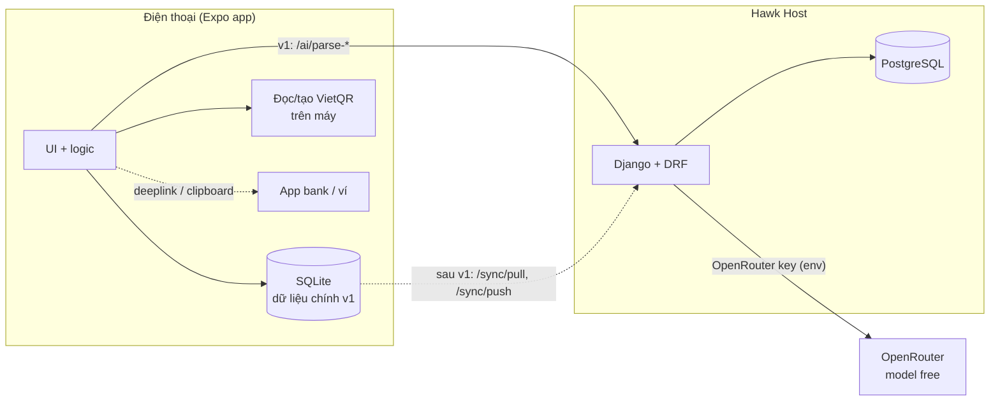

# MoneyMates – Tech stack

Cập nhật: 22/11/2026 · Hoàng Lê

## Tóm tắt quyết định

v1 là app React Native (Expo) lưu dữ liệu trên máy; server duy nhất là một Django API nhỏ trên Hawk Host để giữ OpenRouter key. PostgreSQL và đồng bộ nhóm bật lên khi mở tính năng mời thành viên.

| Hạng mục | Chọn | Lý do chính |
| --- | --- | --- |
| Mobile | React Native + Expo, TypeScript | Dùng lại React/TS đã biết; một codebase iOS + Android |
| Lưu trữ v1 | SQLite trên máy (local-first) | Chạy offline, chi phí 0đ, ra mắt nhanh |
| Backend | Django + DRF trên Hawk Host (Python App) | Đã có hosting, đã quen DRF |
| Database server | PostgreSQL trên Hawk Host | Kiểu numeric cho tiền, JSONB, dễ chuyển sang Supabase/Neon sau này |
| AI | OpenRouter (model free), gọi qua endpoint Django | Key nằm trên server, không nằm trong app |
| Đồng bộ nhóm | Khi mở mời thành viên (sau v1) | Schema v1 thiết kế sẵn cho sync |

Nguyên tắc cứng: app không bao giờ chứa thông tin kết nối DB hay API key; mọi thứ đi qua Django API.

## Kiến trúc

- **v1:** app chỉ gọi server cho AI. PostgreSQL chưa cần dùng (có thể tạo sẵn cho Django).
- **Sau v1:** bật đăng nhập + sync; dữ liệu nhóm lấy server làm bản chuẩn, SQLite trên máy là bản cache để chạy offline.

## Mobile app

Expo + TypeScript, dùng development build (không dùng Expo Go) vì cần module native cho nhận dạng giọng nói.

| Chức năng | Thư viện / cách làm |
| --- | --- |
| Điều hướng, tab bar | expo-router |
| DB trên máy | expo-sqlite + Drizzle ORM (schema + migration bằng TypeScript) |
| State UI | Zustand |
| Gọi API | fetch + TanStack Query |
| Quét QR bằng camera | expo-camera (có sẵn quét mã) |
| Đọc QR từ ảnh thư viện | expo-image-picker + hàm quét mã từ ảnh (cần kiểm tra hỗ trợ trên cả 2 nền tảng) |
| Đọc / tạo VietQR | Tự viết module TLV + CRC16 (nhỏ, test được), không phụ thuộc dịch vụ ngoài |
| Vẽ ảnh QR đòi tiền | react-native-qrcode-svg |
| Tải xuống / chia sẻ ảnh QR | expo-media-library, expo-sharing |
| Mở app bank/ví | expo-linking (deeplink); dự phòng expo-clipboard copy STK + số tiền |
| Voice | Thư viện speech-to-text trên máy hỗ trợ vi-VN (ví dụ expo-speech-recognition, cần thử trước) → rule tách số tiền → gọi AI khi cần |
| Chụp bill | expo-camera / expo-image-picker, nén ảnh trước khi gửi AI |
| Khóa app | expo-local-authentication |
| Ảnh QR có chữ (v1.0.1) | Vẽ mã QR + tên, STK, số tiền trong một View rồi chụp thành PNG (ví dụ react-native-view-shot); lưu ảnh bằng expo-media-library, xoá bằng id ảnh |
| Xoá ảnh QR tạm (v1.0.1) | Android: xoá ảnh do app tạo không cần hỏi (cần kiểm tra expo-media-library có dùng cách này, nếu không thì viết module native nhỏ). iOS: một hộp thoại xoá cho cả lô, cần quyền Ảnh đọc/ghi |
| Nhận ảnh biên lai từ nút Chia sẻ (v1.0.1) | Thư viện nhận share intent hỗ trợ Expo dev build (ví dụ expo-share-intent): Android nhận ảnh, iOS cần Share Extension + App Group |
| Đọc chữ biên lai offline (v1.0.1) | OCR trên máy (ví dụ ML Kit Text Recognition, nhận chữ Latin có tiếng Việt), rồi quy tắc tách số tiền, STK, thời gian theo từng ngân hàng; không gọi AI |
| Đọc thông báo ngân hàng (v1.0.1, chỉ Android) | NotificationListenerService qua module native (thư viện có sẵn hoặc tự viết), chỉ xử lý thông báo của package ngân hàng đang bật |
| Phát hiện app ngân hàng đã cài (v1.0.1) | Android: kiểm tra package đã khai báo trong `<queries>`; iOS: `canOpenURL` với scheme trong `LSApplicationQueriesSchemes` (tối đa 50 scheme) |
| Build & phát hành | EAS Build (build iOS trên cloud, không cần Mac) |

## Backend

Django + DRF chạy bằng tính năng Python App của Hawk Host, PostgreSQL cùng server nên chỉ cần kết nối local. Hawk Host chặn kết nối PostgreSQL từ xa trừ IP được support whitelist, nên app không thể (và không được) nối thẳng DB.

| Giai đoạn | Endpoint | Ghi chú |
| --- | --- | --- |
| v1 | POST /ai/parse-text | Nhận câu voice đã chuyển chữ, trả JSON số tiền / danh mục / ghi chú / người chi |
| v1 | POST /ai/parse-bill | Nhận ảnh bill đã nén, trả JSON tổng tiền / quán / ngày / danh mục gợi ý |
| v1 | Giới hạn request | Theo device id + app secret, để không ai xài hết quota OpenRouter |
| Sau v1 | /auth/* | Đăng nhập bằng email OTP (miễn phí), mở cho cả Free; SMS OTP tốn phí nên để sau |
| Sau v1 | /sync/pull, /sync/push | Đồng bộ theo updated_at; server là bản chuẩn cho dữ liệu nhóm |
| Sau v1 | /groups/{id}/invites | Mời thành viên bằng email hoặc số điện thoại, ghép vào thành viên đã có theo tên |

OpenRouter key, DB password, SECRET_KEY để trong biến môi trường của Python App trên Hawk Host. Endpoint AI khai báo 2–3 model free làm dự phòng.

## Free / Pro

**v1:** không kiểm tra gói, không giới hạn; mọi cờ tính năng trả về "bật". Phần dưới làm khi phổ biến app.

Free chạy hoàn toàn trên máy. Pro gồm mọi thứ tốn tài nguyên server: AI, lưu dữ liệu cá nhân trên server, sync nhiều máy, tạo nhóm chung và mời thành viên. Ai cũng đăng nhập được (không bắt buộc); người được mời vào nhóm chung dùng Free vẫn tham gia được. Giai đoạn dùng cá nhân vẫn bật AI, nhưng làm sẵn các điểm sau để lúc khóa không phải sửa nhiều.

- **Cờ tính năng:** app hỏi server `GET /me/features` (v1 trả về cấu hình cố định: AI bật); UI ẩn/khóa theo cờ, không hard-code.
- **Kiểm tra quyền ở server:** mọi endpoint `/ai/*`, `/sync/*` (dữ liệu cá nhân) và tạo nhóm chung / mời thành viên kiểm tra quyền Pro trên Django. Chỉ khóa ở app là không đủ vì ai cũng gọi thẳng API được.
- **Nhóm trên máy → nhóm chung:** Free tạo nhóm và thành viên ghi tên trên SQLite như bình thường. Pro bấm "Chia sẻ nhóm" thì nhóm đó (kèm giao dịch, phần chia) được đẩy lên server; các nhóm khác vẫn chỉ nằm trên máy.
- **Giới hạn tài nguyên:** server kiểm tra số nhóm chung đang hoạt động và số thành viên mỗi nhóm theo gói (cấu hình được, không hard-code).
- **Quyền theo nhóm:** nhóm chung thuộc về người tạo; khi người tạo còn Pro thì mọi thành viên (kể cả Free) đọc/ghi được; người tạo hết Pro thì nhóm chuyển chỉ xem.
- **Tài nguyên của user Free đã đăng nhập:** server chỉ lưu tài khoản + dữ liệu các nhóm chung họ tham gia, không lưu dữ liệu cá nhân.
- **Đếm người dùng:** analytics ẩn danh cho cả người chưa đăng nhập (ví dụ PostHog có gói free, cần kiểm tra), số tài khoản lấy từ DB.
- **Backup Free:** xuất/nhập file JSON trên máy (expo-file-system + expo-sharing / expo-document-picker), không qua server.
- **Nâng cấp lên Pro:** lần sync đầu đẩy toàn bộ SQLite lên server; schema đã sync-ready nên không cần đổi ID.
- **Thanh toán:** tính năng số bán trong app iOS/Android thường phải đi qua In-App Purchase của Apple/Google (cần kiểm tra quy định lúc làm). Có thể dùng một dịch vụ quản lý gói thuê bao (ví dụ RevenueCat) để gộp iOS + Android, server nhận webhook để cập nhật quyền Pro.
- **Model AI:** user Pro trả tiền nên cần ổn định hơn model free; cân nhắc model trả phí rẻ trên OpenRouter cho Pro, model free cho giai đoạn cá nhân.
- **Phân tích chi tiêu bằng AI:** cần gửi dữ liệu chi tiêu đã tổng hợp (theo danh mục, theo tháng) lên server, không gửi toàn bộ giao dịch thô; nếu dữ liệu chỉ nằm trên máy thì app tự tổng hợp rồi gửi.
- **Endpoint thêm:** `POST /ai/insights` (phân tích chi tiêu), `GET /me/features`, webhook nhận trạng thái thuê bao.

## Dữ liệu: quy tắc để sau này sync được

Làm đúng từ v1 thì lúc bật sync không phải migrate dữ liệu cũ.

- **ID:** UUID sinh trên máy (không dùng auto-increment), để máy và server không đụng ID.
- **Thời gian:** mọi bảng có `created_at`, `updated_at` (UTC); sửa gì cũng cập nhật `updated_at`.
- **Xóa mềm:** dùng `deleted_at` thay vì xóa hẳn, để lần sync sau báo được cho máy khác.
- **Tiền:** lưu số nguyên theo đồng (VND không có số lẻ), kèm `currency`; không dùng float. Trên PostgreSQL dùng `numeric`/`bigint`.
- **Chủ sở hữu:** thêm `owner_id` (để trống ở v1) cho dữ liệu cá nhân; dữ liệu nhóm gắn `group_id`.
- **Thành viên nhóm:** `GroupMember` có thêm `user_id?` để sau này ghép thành viên "theo tên" với tài khoản thật khi họ nhận lời mời.
- **Xung đột:** bản ghi nào có `updated_at` mới hơn thì thắng (last-write-wins theo từng dòng); đủ dùng cho app thu chi.
- **Schema dùng chung:** đặt tên bảng/trường giống nhau giữa Drizzle (SQLite) và Django models (PostgreSQL).

## Chi phí dự kiến

| Hạng mục | Chi phí | Ghi chú |
| --- | --- | --- |
| Hawk Host (Django + PostgreSQL) | 0đ thêm | Dùng gói shared đang có |
| OpenRouter | 0đ | Model free: 20 req/phút, 50 req/ngày; nạp $10 một lần thì lên 1.000 req/ngày |
| Expo / EAS Build | 0đ | Gói free đủ cho cá nhân (cần kiểm tra giới hạn build/tháng) |
| Cài app lên iPhone | ~99 USD/năm nếu cần dùng lâu dài | Apple Developer Program; không có thì bản cài thử chỉ chạy vài ngày. Cần kiểm tra |
| Google Play (nếu phát hành) | ~25 USD một lần | Cần kiểm tra; dùng cá nhân thì cài file APK là đủ |

## Rủi ro & việc cần kiểm tra

| Rủi ro / việc cần kiểm tra | Cách xử lý |
| --- | --- |
| Python App trên shared hosting có giới hạn tài nguyên, có thể khởi động chậm sau thời gian không dùng | Endpoint AI nhẹ, có timeout; nếu không ổn thì chuyển proxy sang Cloudflare Worker (free 100.000 request/ngày) |
| Shared hosting thường không hỗ trợ WebSocket | Sync bằng pull định kỳ / khi mở app, không cần realtime |
| Phiên bản Python/Django mà Hawk Host hỗ trợ | Kiểm tra trong cPanel trước khi dựng dự án |
| Thư viện speech-to-text nhận tiếng Việt tốt trên cả iOS và Android | Thử sớm bằng một màn demo |
| Quét QR từ ảnh thư viện trên iOS và Android | Thử sớm; dự phòng bằng thư viện quét ảnh khác |
| Deeplink autofill của từng bank/ví | Test thực tế 5 app đang dùng |
| Quota OpenRouter khi nhiều người dùng chung 1 key | Giới hạn theo thiết bị; khi có gói Pro thì chỉ user Pro gọi được AI, dùng model trả phí cho Pro |
| Phí và quy định In-App Purchase của Apple/Google | Kiểm tra khi chuẩn bị ra gói Pro, tính vào giá gói |
| Thư viện share intent, OCR, đọc thông báo có chạy với bản Expo SDK đang dùng (v1.0.1) | Thử từng thư viện bằng một spike nhỏ trước khi làm tính năng; chỉ dùng phiên bản tương thích qua `npx expo install` |
| OCR tiếng Việt trên biên lai của từng ngân hàng (v1.0.1) | Gom ảnh biên lai mẫu làm fixture test; không khớp thì luôn cho nhập tay |
| Chính sách Google Play với quyền đọc thông báo (v1.0.1) | Khai báo trong Data safety, màn giải thích trong app, tính năng tuỳ chọn |

## Nguồn

- [Hawk Host – Cho phép kết nối PostgreSQL từ xa](https://www.hawkhost.com/kb/web-hosting/how-do-i-allow-remote-postgresql-connections/)
- [Hawk Host – Python hosting](https://www.hawkhost.com/python-hosting)
- [OpenRouter – Giới hạn model free](https://openrouter.zendesk.com/hc/en-us/articles/39501163636379)
- [Cloudflare Workers – Limits](https://developers.cloudflare.com/workers/platform/limits)
- [CopilotKit – React Native (cần Copilot Runtime server, nên không chọn)](https://docs.copilotkit.ai/react-native)
- [Supabase – Pausing gói Free (phương án DB đã cân nhắc)](https://supabase.com/kb/faqs/platform/free-project-pausing)
